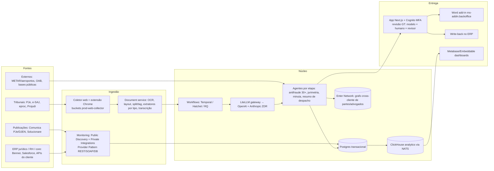

# Enter dissecada: o que copiar, o que evitar

**Posição em 19/10/2026. Clean-room: só fontes públicas. Rótulos: [declarado] = dito pela Enter, por executivo ou por fonte primária; [reportado] = imprensa/terceiro; [inferido] = dedução a partir de evidência pública citada.**

A Enter (razão social Talisman AI Ltda., CNPJ 52.548.809/0001-56, aberta em 17/10/2023) não é um "robô que faz contestação": é uma **esteira de integração de dados + agentes por etapa processual + revisão humana obrigatória**, vendida a departamentos jurídicos de grandes litigantes por contrato anual (média de ~R$ 4 mi/ano em set/2025) com ~30% da receita atrelada a êxito, que em 36 meses chegou a 60 clientes, 300 mil+ processos/ano e valuation de US$ 1,2 bi (Série B de US$ 100 mi+ liderada pelo Founders Fund, 05/05/2026) ([Startups.com.br](https://startups.com.br/negocios/rodada-de-investimento/enter-capta-r-500m-e-cria-1o-unicornio-de-ia-da-america-latina/); [Bloomberg Línea](https://www.bloomberglinea.com.br/startups/enter-startup-brasileira-de-ia-juridica-atinge-us-12-bilhao-em-aporte/)). O produto é replicável em escala regional: o núcleo técnico (OCR + extração estruturada + vínculo com o registro interno do cliente + antifraude determinístico + minuta parametrizada por tese pré-aprovada + monitoramento de publicações + write-back no ERP) usa componentes de prateleira e LLMs de API que a Tucupy já opera; o que **não** é replicável barato é o time forward-deployed dentro do cliente, a base cross-cliente "Enter Network" e o capital para absorver 30% de risco de êxito. O risco regulatório é real e **favorece o Gustavo**: a ACP da OAB-SP (proc. 5031169-20.2026.4.03.6100, 4ª Vara Cível Federal/SP, 07/10/2026) ataca justamente o arranjo "empresa de tecnologia não inscrita vende estratégia + minuta e cobra por êxito", e o pedido subsidiário restringe essa venda a sociedades de advogados inscritas ([Lawletter](https://lawletter.com.br/exclusiva/oab-sp-acao-civil-publica-enter-inteligencia-artificial)). Uma esteira própria dentro da FBS (sociedade inscrita), com a Tucupy como fornecedora de software a preço fixo, fica do lado seguro da linha que a OAB está tentando traçar. **Recomendação: executar a frente 1 (piloto "Águia Peregrina" na FBS) imediatamente, desenhar desde o dia 1 para virar a frente 2 (produto Tucupy para mid-market do Norte), tratar a frente 3 (parceiro/revisor da Enter) como opção de baixo custo a ser testada em paralelo via "última milha" (audiência/preposto/diligência no PA/AP/AM), e usar este dossiê como base da frente 4.**

---

## 1. Sumário executivo e opções para o Gustavo

### O que a Enter é, em uma frase por camada

| Camada | Síntese | Confiança |
|---|---|---|
| Negócio | Enterprise AI B2B para jurídico de grandes litigantes; contrato anual pago antecipado + ~30% êxito; 60 clientes (out/2026); ARR não auditado (R$ 50 mi em 2025 com crescimento "10–13x", claim) | alta nos fatos, baixa na receita |
| Produto | "EnterOS": por processo novo, agentes coletam autos + subsídios internos, enriquecem com dados externos, rodam 30+ checagens de fraude, calculam exposição/acordo, geram minuta parametrizada; advogado do cliente revisa, assina e protocola | alta (7 cases públicos + strings do app) |
| Tecnologia | AWS/K8s, Python (FastAPI) + Go, Temporal/Hatchet, Postgres + ClickHouse, OpenAI + Anthropic via LiteLLM com ZDR, OCR/extratores próprios, coletor web + extensão Chrome, provedores de publicação (Comunica PJe, Solucionare) | média-alta (blog técnico + CT logs + headers) |
| Time | ~100–200 pessoas (fontes divergem), 100% presencial em Pinheiros/SP; CTO ex-Wildlife; engenharia agnóstica de linguagem; "AI Deployment" (não engenheiros) customiza por cliente | média |
| Regulatório | ACP OAB-SP + OAB-RJ; sem liminar até 15/10/2026; defesa Pinheiro Neto (fonte única); Res. CFOAB 16/2026 cria saída via TAC | alta nos fatos processuais |
| Mercado | Único agente full-stack com capital; Finch, Projuris/Softplan, Jusbrasil, TOTVS/TR como alternativas; Norte sem nenhum player de IA | alta |

### Três opções (não excludentes) e a recomendação

**Opção A — "Águia Peregrina" como esteira interna da FBS (frente 1), evoluindo para produto Tucupy (frente 2).**
Prós: fica do lado certo da ACP (quem vende estratégia + minuta é sociedade de advogados inscrita; a Tucupy licencia software a preço fixo); aproveita stack que o Gustavo já opera (Laravel/Postgres/Railway/Claude/OpenAI/MCPs); o whitespace regional é concreto (Equatorial Pará com ~15,5 mil processos pendentes no TJPA em fev/2023, Banpará, Basa, Norte Energia, Unimed Belém, municípios) e nenhum concorrente de IA atua nele ([TJPA Coord. Estatística](https://www.tjpa.jus.br/CMSPortal/VisualizarArquivo?idArquivo=1254556)). Contras: exige capacidade humana de revisão proporcional ao volume (o argumento central da OAB é aritmético); o produto trabalhista da Enter levou 2 anos para chegar a 5 clientes, sinal de que audiência é a parte difícil; integração com ERP/sistemas do cliente é "a parte mais difícil" segundo o próprio CEO ([Bloomberg Línea](https://www.bloomberglinea.com.br/startups/enter-startup-brasileira-de-ia-juridica-atinge-us-12-bilhao-em-aporte/)).

**Opção B — FBS como escritório parceiro/revisor da Enter no Norte (frente 3).**
Prós: custo de entrada zero; a Enter não faz audiência, preposto nem diligência ("essa camada segue sendo humana e local, comarca por comarca") e tem clientes com volume no PA (Azul 875 e Agibank 476 processos distintos em publicações do DJEN/TJPA em set/2026, Bradesco, Santander, Nubank, C6, BMG) ([acheprocesso](https://acheprocesso.com.br/empresas/tribunal/tjpa)). Contras: nenhum escritório parceiro é nomeado em fonte alguma e o menu "Parceiros" do site está vazio; relatos (não comprovados) de advogados descrevem subcontratação com "pedacinho pequeno" da remuneração e proibição de contato com o cliente final ([LinkedIn fgx](https://pt.linkedin.com/posts/fgx_a-advocacia-empresarial-est%C3%A1-sob-amea%C3%A7a-por-activity-7384630122982846464-Bl94); [LinkedIn Borja](https://pt.linkedin.com/posts/joaobeniborja_a-oab-de-s%C3%A3o-paulo-ajuizou-uma-a%C3%A7%C3%A3o-civil-activity-7514389658311503872-M1rW)); se houver fluxo financeiro Enter→escritório vinculado a causa/resultado, o escritório fica exposto ao art. 34, I e IV do EAOAB e aos arts. 48–49 do CED (ver §6). Risco reputacional de estar "do lado errado" da ACP no momento em que a OAB pede a identificação de escritórios "com vínculos" com a Enter.

**Opção C — Só inteligência (frente 4), sem construir.**
Prós: zero custo. Contras: o mercado está se consolidando (Jusbrasil comprou MinutaIA, ADVBOX comprou LawX, Jusfy levantou US$ 15 mi em jul/2026) e os clientes já "cobram ganhos de IA nos honorários" ([Análise, 28/07/2026](https://analise.com/noticias/honorarios-e-estagiarios-na-mira-da-ia)); esperar significa que a FBS será comprimida pela esteira de outro.

**Recomendação: A, com B testada em paralelo apenas como "última milha" (sem receber causas distribuídas onerosamente pela Enter e sem qualquer repasse vinculado a êxito) e C como subproduto de A.** Justificativa curta: o diferencial defensável da Enter não é o código, é (i) estar dentro do cliente com engenheiros dedicados, (ii) a base cross-cliente e (iii) o capital; nada disso é necessário para servir réus regionais de 500–20 mil processos, e a estrutura jurídica da FBS + Tucupy é a que a OAB está, na prática, tentando tornar obrigatória.

---

## 2. Identidade e negócio

### Identificação

Talisman AI Ltda., nome fantasia Enter, CNPJ 52.548.809/0001-56, aberta em 17/10/2023, CNAE 62.02-3-00, capital social R$ 100 milhões, sede na Rua Cardeal Arcoverde, Pinheiros, São Paulo; sócia PJ "Talisman AI Intermediate Holdings LLC" (EUA); administradores Henrique Vieira Gonçalves Vaz e Mateus de Lima Costa Ribeiro ([ReceitaWS](https://receitaws.com.br/v1/cnpj/52548809000156)). Carey Olsen (Cayman) assessorou as Séries A e B, indício [inferido] de holding em Cayman ([Carey Olsen, 11/05/2026](https://www.careyolsen.com/node/5814)). Domínio getenter.ai (legado talismanai.co redireciona). Marca ENTER depositada no USPTO (serial 99068985, 05/03/2025) ([Justia](https://trademarks.justia.com/owners/1-talisman-ai-ltda-6220038)); INPI não consultado (lacuna).

### Linha do tempo

| Data | Evento | Fonte |
|---|---|---|
| set/2023 | Início com 6 pessoas; CEO opera do dormitório de Stanford; v1 = formulário que recebe PDF da inicial e devolve contestação por e-mail; receita de R$ 8 mil→R$ 80 mil/mês em 5 meses | [Portal Tela](https://www.portaltela.com/noticias/economia/2026/05/15/brasil-mira-top-5-global-em-ia-diz-fundador-do-1o-unicornio-da-america-latina/); [Area18](https://www.area18.com.br/noticia/4516/mundo/enter-o-que-faz-a-startup-brasileira-de-ia-que-se-tornou-unicornio-e-ja-vale-us-1-2-bilhao.html); [InvestNews](https://investnews.com.br/negocios/o-jovem-de-26-anos-que-levou-ia-para-o-mundo-dos-advogados-atraiu-peter-thiel-e-sequoia-e-agora-incomoda-a-oab/) |
| fim/2023 | Pré-seed/seed ONEVC (valor não divulgado); ONEVC traz dois clientes enterprise | [BrazilCham](https://www.brazilcham.com/news/posts/sequoia-is-back-in-brazil-co-investing-with-onevc) |
| 2024 | Piloto de 200 casos em grande banco: extrair dados da inicial, processar provas, gerar Word para revisão humana | [Carta do CEO, 23/09/2025](https://getenter.ai/en/news/enter-os-primeiros-dois-anos) |
| ~jun/2024 (anunciada 10/03/2025) | Rodada Sequoia + Atlantico; total acumulado US$ 5,5 mi; primeiro cheque da Sequoia no Brasil em 12 anos | [Brazil Journal](https://braziljournal.com/enter-usa-ai-para-desafogar-acoes-trabalhistas-e-de-consumidores-e-ja-atraiu-o-sequoia/) |
| 25/02/2025 | OpenAI aprova ZDR (introdução da Sequoia) | [Inside Story](https://www.getenter.ai/en/news/inside-story) |
| mar/2025 | 12–13 clientes; 34 mil contestações acumuladas | [Brazil Journal](https://braziljournal.com/enter-usa-ai-para-desafogar-acoes-trabalhistas-e-de-consumidores-e-ja-atraiu-o-sequoia/) |
| 24–25/09/2025 | **Série A**: R$ 200 mi / US$ 35 mi, co-liderada por Founders Fund e Sequoia, post-money R$ 2 bi / US$ 350 mi; 15 clientes listados; contrato médio ~R$ 4 mi/ano | [Brazil Journal](https://braziljournal.com/the-founders-fund-de-peter-thiel-avalia-a-enter-em-r-2-bilhoes); [Bernama/PR](https://web11.bernama.com/en/press/news.php?id=2471259) |
| 21/10/2025 | Enter Elevate 2025 (Palácio Tangará): lançamento do EnterOS; Alckmin em vídeo, Huck, Sallouti, AGU | [getenter.ai](https://www.getenter.ai/en/news/enter-elevate-2025-onde-as-maiores-liderancas-do-brasil-redefinem-o-juridico-com-ia) |
| 05/05/2026 | **Série B**: US$ 100 mi+ / R$ 500 mi, Founders Fund líder, Ribbit, Sequoia, ONEVC, Atlantico, Kaszek; US$ 1,2 bi; "já gerava caixa"; 300 mil+ processos/ano; ~20 bi tokens/dia | [getenter.ai](https://getenter.ai/en/news/enter-levanta-mais-de-us-100-milhoes-e-se-torna-o-primeiro-unicornio-de-ia-da-america-latina); [Startups.com.br](https://startups.com.br/negocios/rodada-de-investimento/enter-capta-r-500m-e-cria-1o-unicornio-de-ia-da-america-latina/) |
| mai/2026 | Conselho Institucional (Barroso, Huck, Quiroga); parcerias de letramento com OAB-PR/DF/PI; acesso à API pública do Judiciário validado pelo CNJ | [BP Money](https://bpmoney.com.br/?p=401727) |
| ago/2026 | Venda secundária aberta a todo o time; Enter Elevate 2026 (25/08) com meta de economizar R$ 2 bi em condenações em 12 meses; Pleno do CFOAB autoriza ações contra IAs que pratiquem atos privativos (17/08) | [getenter.ai](https://www.getenter.ai/en/news/por-que-fizemos-a-primeira-venda-de-acoes-secundarias-em-uma-serie-b-no-brasil); [Veja](https://veja.abril.com.br/economia/meta-bilionaria-da-enter-esbarra-em-ofensiva-da-oab-contra-ia-juridica/); [OAB](https://www.oab.org.br/noticia/64465/oab-defende-advocacia-contra-empresas-de-ia-que-praticarem-atos-exclusivos-da-classe) |
| 21/09/2026 | "Pesquisa Enter 2026" com suporte da Bain | [getenter.ai/pesquisa](https://www.getenter.ai/pesquisa) |
| 07–09/10/2026 | ACP OAB-SP (229 páginas); OAB-RJ pede ingresso; artigo patrocinado do CEO no Migalhas (08/10) | [Lawletter](https://lawletter.com.br/exclusiva/oab-sp-acao-civil-publica-enter-inteligencia-artificial); [OAB-RJ](https://oabrj.org.br/noticias/oabrj-vai-justica-defender-limites-ao-uso-ia-atividades-privativas-advocacia) |
| 15/10/2026 | Resolução CFOAB 16/2026 disciplina TACs com empresas de IA jurídica | [Jurinews](https://jurinews.com.br/en/destaques-ultimas/oab-establishes-rules-for-agreements-with-ai-companies-operating-in-the-legal-market) |

**Conflito de nomenclatura (explícito):** a pergunta original falava em "Série A Sequoia mar/2025, Série B FF set/2025, Série C US$ 100 mi". As fontes primárias (empresa, KLA, Carey Olsen, Gunderson) chamam a rodada de set/2025 de **Série A** e a de mai/2026 de **Série B**; a rodada Sequoia de 2024 é tratada como seed. Não existe "Série C". Divergências menores: LatamList registra US$ 37,5 mi / US$ 375 mi para a Série A ([LatamList](https://latamlist.com/enter-raises-37-5m-led-by-founders-fund/)); Forbes Under 30 fala em "US$ 50 mi" ([Forbes](https://forbes.com.br/under-30/2025/business-industria-u30-2025/mateus-costa-ribeiro/)); Sacra inclui Kaszek na Série A sem confirmação ([Sacra](https://sacra.com/c/enter/)). Total divulgado: >US$ 140 mi.

### Clientes e métricas

Contagem oficial: 12–13 (mar/2025) → 15 (set/2025) → 40–45 (mai/2026) → 60 (set–out/2026). Nomeados em alguma fonte: Nubank, C6, SulAmérica, BMG, Agibank, Vivo, Light, Inter, iFood, LATAM, Mercado Livre, Magalu, Santander, Itaú, Banco Mercantil, Bradesco, Azul, Airbnb, AeC, Neon (jul/2026). Uber não aparece em fonte alguma. Verticais declaradas: aviação, finanças, tecnologia, varejo; "100% das grandes aéreas do Brasil" (claim do CEO em conteúdo patrocinado) ([Migalhas](https://www.migalhas.com.br/depeso/466112/ia-aumentou-vagas-e-salarios-no-contencioso-de-massa)). Trabalhista: 5 clientes em mai/2026 ([Startups.com.br](https://startups.com.br/negocios/rodada-de-investimento/enter-capta-r-500m-e-cria-1o-unicornio-de-ia-da-america-latina/)).

Resultados declarados por cliente (todos auto-reportados, sem metodologia): Nubank +6 p.p. de êxito (o site também diz +9 p.p.) e implantação 2,5x mais rápida; Mercado Livre 100% das novas ações de consumo, +9 p.p., US$ 1 mi economizado em 5 mil casos; LATAM 120 mil processos/ano, minutas em 70% do volume, +30% improcedência, −13% condenação média, R$ 15 mi no 1º ano; Agibank +9 p.p., −28% custo/processo; Mercantil +12 p.p., −25% custo; BMG tempo por resposta de 45 para 21 minutos; AeC +44 p.p. em um pedido trabalhista ([cases em getenter.ai](https://www.getenter.ai/customer-stories/latam)). Share of wallet: ~15% na entrada chegando a ~60% em 12 meses; Nubank 8%→80%, Mercado Livre 10%→100%, LATAM 12%→70% ([Brazil Journal](https://braziljournal.com/the-founders-fund-de-peter-thiel-avalia-a-enter-em-r-2-bilhoes)).

Volume: 34 mil contestações acumuladas (mar/2025) → 250 mil processos projetados em 2025 (~14% do cível das 10 empresas mais acionadas) → 300 mil+/ano (mai/2026) → "840 milhões de documentos e 6+ trilhões de tokens/ano" (set/2026) ([getenter.ai/pesquisa](https://www.getenter.ai/pesquisa)).

Receita: Brazil Journal estima ~R$ 60 mi/ano implícitos em set/2025 (15 clientes × ~R$ 4 mi); a empresa declara ARR de R$ 50 mi em 2025 e crescimento de "10x desde a Série A" / "13x" ([Startups.com.br](https://startups.com.br/negocios/rodada-de-investimento/enter-capta-r-500m-e-cria-1o-unicornio-de-ia-da-america-latina/); [BP Money](https://bpmoney.com.br/?p=401727)). [inferido] Se os 10x valem sobre ~R$ 50–60 mi, o ARR em mai/2026 estaria em R$ 500–650 mi e o múltiplo do valuation em ~10–12x, compatível com "gerando caixa"; se o período for outro, o múltiplo passa de 100x. Nenhuma receita auditada é pública.

**Conflito de headcount (explícito):** Bloomberg Línea diz ~100 pessoas com meta de 150 (05/05/2026); Startups.com.br, no mesmo dia, diz ~200 após contratar 80 engenheiros, >85% técnicos ([Bloomberg Línea](https://www.bloomberglinea.com.br/startups/enter-startup-brasileira-de-ia-juridica-atinge-us-12-bilhao-em-aporte/); [Startups.com.br](https://startups.com.br/negocios/rodada-de-investimento/enter-capta-r-500m-e-cria-1o-unicornio-de-ia-da-america-latina/)). Enriquecimento LinkedIn: 100–150 (+280% a/a). A leitura mais provável [inferido]: ~100 em mai/2026 com plano de chegar a ~200; o "200" da Startups.com.br é meta, não estado.

### Modelo comercial

[declarado] "Cerca de 30% da remuneração depende do êxito dos casos; o restante é pago antecipadamente pelo uso da tecnologia" ([Bloomberg Línea](https://www.bloomberglinea.com.br/startups/enter-startup-brasileira-de-ia-juridica-atinge-us-12-bilhao-em-aporte/)). Contrato médio ~R$ 4 mi/ano (US$ 750 mil) em set/2025 ([LatamList](https://latamlist.com/enter-raises-37-5m-led-by-founders-fund/)). Quem paga é o departamento jurídico; os escritórios continuam contratados e pagos pelas empresas, e operam dentro do EnterOS. Nenhuma fonte define contratualmente "êxito" (improcedência? economia vs. provisão? acordo abaixo de X?), nem publica preço por caso, nem confirma qualquer fluxo financeiro Enter→escritório. O "43%" que circula é salário de advogados plenos em escritórios que usam a Enter vs. pares (dado interno, sem amostra), não remuneração paga pela Enter ([getenter.ai/pesquisa](https://www.getenter.ai/pesquisa)). [inferido] O componente de êxito é provavelmente medido por taxa de improcedência ou economia de condenação por caso, porque são essas as métricas que a Enter divulga aos clientes; a Enter captura valor da condenação evitada (ticket médio aéreo R$ 6.700), não do honorário do escritório, e é por isso que o cliente aceita enquanto o escritório vê sua fatia comprimida.

Proposta comercial inclui compliance: SOC 2, ISO 27001/27701 (em processo), LGPD, AWS, ZDR com OpenAI e Anthropic, sem treinamento com dados do cliente ([getenter.ai/seguranca](https://www.getenter.ai/seguranca)).

### Pessoas

Mateus Costa-Ribeiro (CEO, 26 anos; Direito UnB aos 14, sustentação oral no STF aos 18, LL.M. Harvard, NY Bar, Milbank, Knight-Hennessy/Stanford por um semestre; cuida de estratégia e clientes); Henrique Vaz (CPO; CS Harvard, ex-Tesla, ex-CMO Wildlife); Michael "Mike" Mac-Vicar (CTO; École Polytechnique, cofundador e CTO da Wildlife Studios por 12–13 anos) ([Brazil Journal](https://braziljournal.com/enter-usa-ai-para-desafogar-acoes-trabalhistas-e-de-consumidores-e-ja-atraiu-o-sequoia/); [Startupeable](https://startupeable.com/en/enter-mike-macvicar/)). Executivos: Arthur Dalmarco (CLO e DPO), Geovana Guimarães (Legal Manager) ([KLA](https://www.klalaw.com.br/en/kla-advises-enter-on-becoming-latin-americas-first-ai-unicorn/)). Conselho Institucional sem equity: Luís Roberto Barroso, Luciano Huck, Roberto Quiroga ([BP Money](https://bpmoney.com.br/?p=401727)). Investidores-pessoa: Konstantine Buhler (Sequoia), Matias Van Thienen (Founders Fund). Estratégia declarada: "enterprise AI, não legaltech"; "três capítulos" (consumidor → trabalhista/Procon/BC → internacional); ambição de "força monopolística" em IA jurídica na América Latina; horizonte internacional alongou de "3–4 anos" (set/2025) para "menos de dez anos" (out/2026) ([InvestNews](https://investnews.com.br/negocios/o-jovem-de-26-anos-que-levou-ia-para-o-mundo-dos-advogados-atraiu-peter-thiel-e-sequoia-e-agora-incomoda-a-oab/)).

---

## 3. Fluxo operacional reconstruído

### Esteira cível/consumidor (canônica, reconstruída a partir de getenter.ai/civel, home e 7 cases)

| # | Etapa | O que o agente faz | Onde entra o humano | Rótulo |
|---|---|---|---|---|
| 0 | Parametrização | — | Jurídico do cliente + "Legal Strategist" da Enter definem "critérios de resposta por tipo de ação" e árvore de teses (Mercado Livre: 50 teses em 31 assuntos) | declarado |
| 1 | Gatilho/coleta | Nova distribuição captada via API tribunal/CNJ e/ou cadastro no ERP jurídico; "Integração via API com tribunais, ERPs jurídicos e sistemas internos" | — | declarado |
| 2 | Leitura dos autos | Leitura multimodal (PDF, áudio de SAC, vídeo, extratos, prints); extração de causa, pedido, produto, valor, partes, advogado | — | declarado |
| 3 | Vínculo com registro interno | Liga o processo ao contrato/voo/reserva/holerite; Nubank: 30+ APIs; cliente médio Agibank tem >5 contratos ativos; sinaliza documentos faltantes | Advogado recebe pendências antes da defesa (Mercantil) | declarado |
| 4 | Reconstrução de fatos | Linha do tempo (compra→entrega→contato→ajuizamento), logs de autenticação, biometria × documento, geolocalização, IP, destino dos valores | — | declarado |
| 5 | Enriquecimento externo | Clima (METAR), status de aeroportos, interrupções de outras cias no mesmo aeroporto/data; bases públicas; situação do advogado na OAB; "Enter Network" cross-cliente | — | declarado |
| 6 | Antifraude | 30+ verificações (procuração inválida, OAB irregular, litispendência, autor falecido, gratuidade indevida, comprovante de terceiro para forçar foro, concentração por autor/advogado); dossiê do litigante | Enter diz que humano valida; OAB alega que a marcação ocorre antes de humano olhar | declarado / contestado |
| 7 | Modelagem financeira/jurimetria | Exposição, condenação média por tese/comarca, reversão recursal, "valor ideal de acordo", sinal acorda × defende | Decisão de acordo é do jurídico/escritório | declarado |
| 8 | Minuta parametrizada | "400+ modelos proprietários" + LLMs geram contestação conforme critérios do passo 0, com evidências anexas e score de relevância por prova; teses específicas (ilegitimidade passiva, má-fé, fracionamento, caso fortuito) | — | declarado |
| 9 | Revisão/assinatura/protocolo | — | Advogado habilitado (interno ou escritório do cliente) revisa, edita, assina e protocola; não há evidência de protocolo automático | declarado |
| 10 | Monitoramento | Resumo de despacho por IA em tempo real; alertas de liminar com obrigações destacadas | — | declarado |
| 11 | Sentença/recurso | Análise de fundamentos, estatísticas de desempenho; minuta de recurso "a partir dos fundamentos da sentença" | Advogado decide e protocola | declarado |
| 12 | Fechamento/ERP | Preenche ERP com resultado, motivo, fase, próxima etapa; sinaliza processos aptos a baixa de provisão | "Ao escritório do banco para validação" (Agibank) | declarado |
| 13 | Loop | "Cada caso retroalimenta a esteira e corrige falhas" | — | declarado |

Fontes: [Enter Cível](https://www.getenter.ai/civel); [Case Agibank](https://getenter.ai/customer-stories/agibank); [Case Nubank](https://www.getenter.ai/en/customer-stories/nubank); [Case LATAM](https://www.getenter.ai/customer-stories/latam); [Case Mercado Livre](https://www.getenter.ai/customer-stories/mercado-livre); [Case Mercantil](https://www.getenter.ai/customer-stories/mercantil).

### Esteira trabalhista (getenter.ai/en/labor-litigation)

Intake via API com tribunais, RH e ERP jurídico → "Claimant Profile" (holerites, ponto, FGTS, fichas, EPI, CCT, férias) → modelo financeiro por processo ("amount in dispute, worst-case exposure, ideal settlement figure", recalculado a cada movimentação) → antifraude → contestação pedido a pedido com jurisprudência do tribunal específico; reuso de laudos periciais do mesmo centro de custo → briefing de audiência (valor de acordo, lista de perguntas, estratégia; testemunhas selecionadas pelo organograma; banco de depoimentos do AeC para apontar contradições) → feedback pós-audiência que "pontua o desempenho do advogado" → recálculo de passivo a cada peça e minuta de recurso ([Labor litigation](https://www.getenter.ai/en/labor-litigation); [Case AeC](https://www.getenter.ai/customer-stories/aec)). [inferido] É o produto menos maduro: 5 clientes em mai/2026 e um único case público (AeC), focado em análise de carteira e testemunhas, não em contestação pedido a pedido.

### Acordos

[declarado] A Enter calcula custo de acordo e "valor ideal" e indica "onde um acordo é mais eficiente que a defesa"; press releases falam em "settlement recommendations"/"negotiating settlements". [inferido] É um motor de recomendação consumido pelo advogado; não há evidência de proposta enviada ao autor, integração com consumidor.gov/CEJUSC ou alçadas automatizadas. "Negociação de acordos" é linguagem de posicionamento.

### Escritórios no fluxo

[declarado] "Um escritório parceiro audita cada contestação antes do protocolo"; "advogados habilitados contratados pelas empresas-clientes" assinam. [inferido] "Parceiro" = escritório já contratado pelo cliente, que passa a trabalhar dentro do EnterOS; a Enter o "audita" indiretamente (taxa de êxito por tese/comarca, scoring pós-audiência, "+55% eficiência dos escritórios" no case SulAmérica) e devolve isso ao jurídico, que gerencia a banca. Com 30% da receita em êxito, a Enter tem incentivo a controlar a qualidade do trabalho do escritório. Há relatos não comprovados de um "segundo ato" (Enter subcontrata escritórios para audiência e despacho) que a ACP pode tornar público via exibição de contratos.

**Divergência sobre o escopo da revisão humana (explícita):** a versão PT do site diz "toda sugestão gerada por IA exige revisão, edição e validação humana"; a versão EN da página trabalhista diz "low-confidence AI suggestions require human validation" ([Labor litigation](https://www.getenter.ai/en/labor-litigation); [Enter home](https://www.getenter.ai/)). O CTO: "o agente praticamente nunca toma a decisão final [...] só age sozinho quando a ação é reversível" ([Startupeable](https://startupeable.com/en/enter-mike-macvicar/)). [inferido] A minuta chega "quase pronta" e a revisão pode ser rápida (BMG: 21 minutos por resposta); é exatamente a qualidade e rastreabilidade dessa revisão, não sua existência, que a OAB ataca.

---

## 4. Arquitetura técnica inferida

### Componentes e rótulos

| Camada | Evidência | Rótulo |
|---|---|---|
| Nuvem: AWS us-east-1 principal; pilha paralela sa-east-1 (`app.br`, Cognito sa-east-1, buckets `sa-ea-1-*`) | Política de privacidade declara us-east-1; CSP e CT logs mostram sa-east-1 | declarado / inferido |
| Kubernetes + ArgoCD; clusters `prod-batch`, `prod-user`, `prod-brazil` | hosts `api.k8s-prod`, `argocd` no crt.sh; blog cita ArgoCD | inferido |
| Backend Python (FastAPI) + Go; frontend React/Next.js; marketing Webflow/Cloudflare | blog técnico; perfil de engenheiro ("Golang, Python, Temporal, PostgreSQL, AWS"); headers | declarado por funcionários |
| Workflows Temporal + Hatchet (+ RQ legado) | perfil + host `temporal`; blog AI Fellowship descreve fan-out com semáforo em Hatchet | declarado / inferido |
| Postgres transacional; NATS JetStream → MooseStack → ClickHouse (~2,5 M eventos/dia); Grafana; Metabase embutido com JWT/RLS; Cube; dbt | blog "Building a generic analytics solution"; hosts `cube.prod`, `dbt-postgresql` | declarado / inferido |
| LLM: OpenAI + Anthropic com ZDR; gateway LiteLLM (`litellm.getenter.ai`); modelos menores onde eval interna permite; sem evidência de open-weights próprios | política de privacidade; DNS TXT com verificação de domínio Anthropic e OpenAI; blog Monitoring | declarado / inferido |
| Documentos: jobs `ProcessOCR`, `TranscribeAudio`, `ProcessLayoutDetector`, `SplitFeatureJob`, `ClassifyFeatureJob`, `InvoiceExtractor`, `TedReportExtractor`, `CcbReportExtractor`, `NubankImageStructuredData`, `CaseHistoryExtractor` | strings i18n no HTML público do login (19/10/2026) | inferido (nomes literais) |
| Tribunais: "strategic partners handle the raw connectivity layer"; provedores `comunica_pje` e `solucionare_diario`; coletor web próprio + extensão Chrome operada por humanos; tarefas `check_tribunal`, `bulk_check_tribunal`, `check_liminar`, `check_audiencia_designada`; PJe-Calc; protocolo humano com upload de recibo (`submitProtocolAgravar`, `submitProtocolEmbargosDeclaracao`...) | blog Monitoring; strings do app | declarado / inferido |
| Integração cliente: Provider Pattern (REST/SOAP/DB legado), Salesforce, Benner; "evoluindo providers para agentes autônomos" que navegam ERPs | blog Monitoring | declarado |
| Controle de qualidade: tarefas de "ground truth" (originLlm / originHuman / originGt), `regenerateAiDialog`, detecção de prompt injection e jurisprudência inexistente em petições adversas; "97% accuracy" (Nubank) sem metodologia | strings do app; case AeC; case Nubank | inferido / declarado |
| Segurança: SOC 2, ISO 27001/27701, LGPD (selos sem tipo/data); Vanta trust center; Cognito MFA obrigatório; SSO; logs; DMARC p=reject; UptimeRobot | getenter.ai/seguranca; DNS/CT | declarado / inferido |
| MCP interno: `mcp-agent-broker.prod`, `mcp-metabase`, `mcp-ashby`, `mcp-tech-docs`, `mcp-auth`, `mcp-cursor` | crt.sh | inferido |
| Word add-in (`ms-addin.backoffice`) para revisão de peças | crt.sh | inferido |

Fontes: [Blog Monitoring](https://www.blog.getenter.ai/en/posts/monitoring-team); [Blog Analytics](https://www.blog.getenter.ai/en/posts/building-a-generic-analytics-solution); [Blog AI Fellowship](https://www.blog.getenter.ai/en/posts/ai-fellowship); [Política de Privacidade](https://www.getenter.ai/en/legal/privacy-policy); [crt.sh](https://crt.sh/?q=%25.getenter.ai); [DNS TXT](https://dns.google/resolve?name=getenter.ai&type=TXT); [LinkedIn Yan Silva](https://linkedin.com/in/yan-silva-82658120a).

### Leituras que importam para replicar

Primeiro, **não há RAG clássico de jurisprudência como centro do produto** [inferido]: o foco é extração/estruturação dos autos e dos subsídios do cliente, checagens determinísticas e jurimetria sobre a própria base; a "alucinação" é contida por grounding nos documentos, não por fine-tuning declarado. Segundo, o CTO é explícito sobre onde está a dificuldade: "the hard part is not the model, it is the context [...] classification, segmentation, connecting systems, and documenting the company's entities and relationships" ([Startupeable](https://startupeable.com/en/enter-mike-macvicar/)). Terceiro, a Enter **terceiriza a conectividade bruta com tribunais** e usa humanos com extensão Chrome para autos restritos; não há evidência de peticionamento eletrônico automatizado. Quarto, a camada de customização por cliente é feita por não engenheiros ("AI Deployment", perfil de consultoria com Make/n8n/Zapier, prompts e SQL) sobre uma plataforma interna ([Ashby](https://api.ashbyhq.com/posting-api/job-board/enter-ai)). Quinto, o Data Engineer "fundador" só foi aberto em ago/2026: até lá o warehouse foi construído por engenheiros de produto, sinal de que a esteira funciona com dados bem menos sofisticados do que o marketing sugere. Nenhuma presença em GitHub/npm/PyPI; nenhum paper; API docs inexistentes.

Lacuna assumida: PJe/e-SAJ/eproc/Projudi só aparecem nominalmente em relato da Enter à imprensa; o blog da JUDIT (fornecedora de API judicial) insinua que a Enter usa sua infraestrutura, mas é afirmação promocional não confirmada ([JUDIT](https://judit.io/blog/noticias/enter-unicornio-ia-judit/)).

---

## 5. Time e organização

ATS Ashby, 24 vagas abertas em 19/10/2026, todas 100% presenciais em Pinheiros: Senior SWE (backend e frontend), Data Engineer (primeiro da área), AI Deployment Associate/Senior/Lead, AI Client Strategy Partner, Staff PM, PM, Head of Design, Product/Brand Designer, Strategy & Ops (CEO Office), Corporate Communications, Head of Tax, consolidação contábil, payroll Brasil & Internacional, dois HRBPs, TA ([Ashby](https://api.ashbyhq.com/posting-api/job-board/enter-ai)). Vagas de engenharia são agnósticas de linguagem por política ("não é preciso dominar uma linguagem ou plataforma específica") e pedem sistemas distribuídos, observabilidade, "não determinismo, latência, flakiness e avaliação contínua de qualidade". Squads por tema (o blog nomeia o squad Monitoring). Perfil de contratação em IA pende para inferência/OCR/document intelligence (ex-H Company/vLLM, Nokia Bell Labs, Qantev, Inria, Microsoft OCR). [inferido] Engenharia + IA ≈ 25–40 pessoas; o restante está em AI Deployment, Legal Strategy, Growth, Produto e G&A. Não há Head of Engineering público; vaga "Head of Engineering Strategy & Ops" estava fechada. Cultura: "Immediate Candor", "Deliver Wow", "The Ship is Sinking Mindset"; 15+ repatriados; secundária aberta a 100% do time ([Os primeiros dois anos](https://www.getenter.ai/en/news/enter-os-primeiros-dois-anos)). Recrutamento de funil: AI Fellowship (Unicamp, 60 dias), Hackathon Enter × Unicamp (12–13/09/2026, 50 vagas), Estágio 2027 com trilha "Legal Strategy" que aceita a partir do 8º semestre ([Veja](https://veja.abril.com.br/economia/meta-bilionaria-da-enter-esbarra-em-ofensiva-da-oab-contra-ia-juridica/)).

O ponto estrutural: a Enter mistura (a) engenheiros de plataforma, (b) "AI Deployment" (consultores que montam agentes por cliente) e (c) "Legal Strategy" (advogados que escrevem playbooks e teses que guiam os agentes). O Gustavo já tem (c) na FBS e (a) na Tucupy; o que falta é (b), e é o papel mais barato de criar.

---

## 6. Risco regulatório: ACP OAB-SP e como operar sem risco

### Fatos processuais

ACP nº 5031169-20.2026.4.03.6100, 4ª Vara Cível Federal de São Paulo, autora OAB-SP, ré Talisman AI Ltda., ajuizada em 07/10/2026 (dia em que a Enter completou 3 anos), inicial de 229 páginas, R$ 1 mi de dano moral coletivo; OAB-RJ pediu ingresso como litisconsorte ativa em 09/10/2026 aderindo integralmente; sem decisão sobre liminares ou sobre o ingresso até 13–15/10/2026; Pinheiro Neto na defesa (fonte única) ([Lawletter](https://lawletter.com.br/exclusiva/oab-sp-acao-civil-publica-enter-inteligencia-artificial); [Migalhas](https://www.migalhas.com.br/quentes/466311/oab-rj-vai-a-justica-contra-ia-por-atividades-privativas-da-advocacia); [Análise](https://analise.com/opiniao/oab-joga-para-a-plateia-e-tapa-o-sol-com-peneira-em-acao-contra-a-enter)). Contexto: o Pleno do CFOAB autorizou em 17/08/2026 medidas judiciais contra IAs que pratiquem atos privativos, inclusive intermediação ([OAB](https://www.oab.org.br/noticia/64465/oab-defende-advocacia-contra-empresas-de-ia-que-praticarem-atos-exclusivos-da-classe)); a Resolução CFOAB 16/2026 (noticiada em 15/10) disciplina TACs facultativos, que não são selo e não impedem ação ([Jurinews](https://jurinews.com.br/en/destaques-ultimas/oab-establishes-rules-for-agreements-with-ai-companies-operating-in-the-legal-market)).

### Teses da OAB-SP

Exercício de atividade privativa (EAOAB arts. 1º, II, 3º e 4º) por pessoa jurídica não inscrita; violação à independência técnica (arts. 18 e 31, §1º); infrações do art. 34 (facilitar exercício por não inscrito; assinar peça sem autoria); Recomendação CFOAB 001/2024; LGPD; publicidade de resultado/economia. "Marcadores objetivos" de substituição ilegítima segundo a inicial: remuneração atrelada ao resultado; estratégia automatizada; minutas validadas em tempo incompatível com leitura; intermediação de causas entre empresas e escritórios ([Migalhas de Peso, Massicano](https://www.migalhas.com.br/depeso/466376/a-advocacia-nao-e-linha-de-producao)). A inicial reproduz publicação da Enter dizendo que seus agentes sugerem minutas para 70% do contencioso de uma aérea com 120 mil processos/ano (~84 mil defesas) e relata pressão sobre advogados para assinar em volume, com retaliação a quem recusa (alegação). Sica: "dizer 'economizar milhões com o meu programa de IA' não é ético nem permitido" ([Debate Jurídico](https://debatejuridico.com.br/oab-sp-x-enter-dizer-economizar-milhoes-com-o-meu-programa-de-ia-nao-e-permitido-diz-sica/)).

### Pedidos

Principal: condicionar as funcionalidades de estratégia e minuta a identificação do advogado em cada minuta, registro de revisão e decisão, identificação de fontes, bloqueio de exportação sem revisão e direito contratual de recusa; vedar remuneração por êxito, estratégia sem decisão registrada de inscrito e distribuição onerosa/seletiva de causas; multa de **R$ 1 mil por minuta** em desconformidade. Subsidiário: restringir estratégia/minuta a advogados e sociedades inscritas, **R$ 50 mil por contrato**. Urgência: preservação de logs/versões de modelos/contratos desde jan/2024 (R$ 100 mil por ato), suspensão de publicidade de "defesas prontas" (R$ 10 mil/dia), proibição de novos contratos sem advogado identificado (R$ 50 mil/contrato). Outros: auditoria independente semestral por ≥5 anos custeada pela Enter, perícia, RIPD, revisão humana antes de classificar litigante como fraudador, ofício à ANPD e MPF, R$ 1 mi ao FDD, contrapropaganda por 12 meses ([Lawletter](https://lawletter.com.br/exclusiva/oab-sp-acao-civil-publica-enter-inteligencia-artificial)). **Gestão processual, organização documental, classificação e jurimetria não são impugnadas** nem no pedido subsidiário.

### Defesa da Enter (pública)

Ferramenta de apoio; revisão, assinatura, protocolo e responsabilidade com advogados contratados pelos clientes; "várias medidas pedidas já fazem parte da operação"; diálogo com o CFOAB há meses; OAB-SP não teria objetado antes (Sica contesta: recebeu diretor e conselheiros duas vezes); "uma seccional não pode pretender efeitos nacionais"; SOC 2, LGPD, ZDR, sem treinamento cruzado ([Lawletter](https://lawletter.com.br/noticia/presidente-da-oab-sp-acusa-enter-de-propagar-mentiras-e-defende-limites-a-ia-juridica)). [inferido] Linha provável: ilegitimidade/territorialidade; atipicidade (software B2B, advogado decide e assina — paralelo Resolve Juizado); livre iniciativa e direito de defesa (CF 170 e 5º, LV); ausência de dano coletivo. O artigo patrocinado com "+43%" e "economia de US$ 1 mi" é frágil e pode virar prova de publicidade de resultado.

### Precedentes

Condenações quando há análise individualizada, estimativa de êxito, promessa de resultado ou intermediação ativa: YouLaw (TRF2, 2014, R$ 20 mil/ato), Indenizar.com (JFDF, 2022), Justify (JFRJ, 25/08/2025, R$ 20 mil/ato; escritório corréu excluído por falta de prova; intermediação transparente sem sugerir êxito não é ilícita), consultoria previdenciária (TRF3, 2025, R$ 450 mil). Derrota da OAB quando a ferramenta só formata dados do usuário sem juízo técnico: Resolve Juizado (TRF2 efeito suspensivo mai/2025; STJ manteve; sentença de improcedência nov/2025 com avisos obrigatórios, invocando Res. CNJ 615/2025 e livre iniciativa) ([Sentença Justify](https://www.migalhas.com.br/arquivos/2025/9/FB9CA14BEE77D4_decisao-oab-rj.pdf); [Migalhas, Resolve Juizado](https://www.migalhas.com.br/quentes/444650/juiz-libera-site-que-vende-peticoes-por-ia-mas-impoe-aviso-ao-usuario)). TED-SP (20/03/2025): plataforma de aproximação ativa = captação; diretório passivo = lícito ([Migalhas](https://www.migalhas.com.br/quentes/428666/plataformas-de-conexao-entre-advogados-e-clientes-fere-codigo-de-etica)). [inferido] O divisor é "estratégia individualizada + êxito + intermediação" (condena) vs. "automação sem juízo técnico" (absolve); a Enter está no primeiro polo pela natureza e no segundo pelo destinatário (B2B, advogado assina). A Justiça Federal prefere **condicionar** a **proibir**, e a inicial foi desenhada para isso.

### Cenários (até 12 meses)

| Cenário | Probabilidade [inferido] | Efeito para FBS/Tucupy |
|---|---|---|
| Liminar/sentença impõe salvaguardas (advogado identificado por peça, log de revisão, fim do êxito, publicidade restrita) | mais provável | Vira o padrão de mercado; uma esteira já construída com trilha de auditoria sai na frente |
| TAC via Res. 16/2026 | plausível | Mesmo efeito prático; Enter legitimada, mas com auditoria |
| Pedido subsidiário acolhido (só inscritos compram estratégia + minuta) | menos provável, mas possível | Escritórios inscritos viram canal obrigatório; FBS passa a ser compradora/revendedora natural no Norte |
| Improcedência total (livre iniciativa) | possível | Enter acelera; concorrência via copilotos e ERPs se intensifica; compressão de honorários |

### Checklist "como operar o mesmo modelo sem risco"

Síntese dos pedidos da OAB-SP, Recomendação 001/2024, Res. CFOAB 16/2026, Res. CNJ 615/2025 (alto risco para avaliação de provas, conclusões jurídicas e perfilamento) e dos precedentes ([Voto CFOAB 001/2024](https://migalhas.com.br/arquivos/2024/11/94F37C9909D4B0_49.0000.2024.007325-9-Relator-.pdf); [Res. CNJ 615/2025](https://atos.cnj.jus.br/files/original1555302025031467d4517244566.pdf); [Prov. 205/2021](https://www.oab.org.br/leisnormas/legislacao/provimentos/205-2021)):

1. **Sujeito que vende "estratégia + minuta" = FBS (sociedade inscrita) ou o jurídico interno do cliente.** A Tucupy licencia software por preço fixo/por volume, nunca por êxito, sem participação em honorários. Honorários (fixo + êxito, se quiser) são da FBS.
2. **Tese antes da máquina:** advogado responsável aprova por escrito a árvore de teses por tipologia (ex.: cancelamento de voo por METAR; consignado não reconhecido com biometria) e as exceções; versionar e guardar ata.
3. **Trilha de auditoria por peça:** nome/OAB do revisor; timestamps geração → abertura → edição → aprovação → protocolo; diff; fontes verificadas; bloqueio de exportação sem aprovação; tempo mínimo de revisão por tipo; direito de recusa sem retaliação em política escrita.
4. **Capacidade compatível com volume:** dimensionar advogados por peças/dia; estagiário/paralegal não é revisor final (Rec. 001/24, 3.6; EAOAB 34, I).
5. **Sem intermediação de causas:** não receber causas "distribuídas" por fornecedor de IA mediante pagamento, nem pagar por indicação.
6. **Publicidade (Prov. 205, arts. 3º, 4º §2º, 6º):** nada de "economize X", "defesas prontas", "+6 p.p."; comunicar "IA sob supervisão de advogado".
7. **Dados:** ZDR/sem treinamento; segregação por cliente; sem reaproveitar teses de um cliente para concorrente; **revisão humana antes de rotular alguém como litigante coordenado/fraudador** (LGPD art. 20); RIPD do fluxo; cuidado reforçado com dados de saúde.
8. **Consentimento escrito do cliente** para uso de IA (Rec. 001/24, 4.1.1) e cláusula de responsabilidade da FBS pelo conteúdo.
9. **Governança:** política interna de IA, comitê de revisão, auditoria interna semestral (espelha o pedido da OAB; útil para eventual TAC).
10. **Monitorar o processo 5031169-20.2026.4.03.6100** e o PL 2338/2023 (relatório da Comissão Especial previsto para jun/2026; estado posterior não verificado).

Ressalva: não há decisão judicial nem orientação do TED-SP específica sobre "software B2B + advogado terceirizado assina"; o checklist é inferência a partir dos pedidos e precedentes, não norma vigente.

---

## 7. Concorrência e mercado

### Mapa por arquétipo (mesmo comprador: jurídico corporativo de massa)

| Arquétipo | Players | O que fazem de diferente | Fonte |
|---|---|---|---|
| Agente full-stack de defesa | **Enter** (único com escala; ~US$ 143 mi captados) | Esteira completa + êxito | [Tracxn](https://tracxn.com/d/explore/legal-tech-startups-in-brazil/__39Q5XnyGRyj9wRLBLCyQnUkO84qTXN4EmRT48QXePyE) |
| ALSP / escritório-tecnologia | **Finch** (JBM/Mandaliti; 900–1.000 funcionários, 300+ clientes, +19–21% a.a.; jurimetria/RPA), **Nelson Wilians** (~1.100 advogados, 400–657 mil processos, 29 filiais), bancas "100% IA" | Tecnologia dentro de sociedade inscrita; incumbentes | [Valor](https://valor.globo.com/empresas/media-e-mais/noticia/2026/02/26/plataformas-de-ia-para-advogados-ganham-escala.ghtml); [ConJur](https://conjur.com.br/conjur-pdf/1904110/) |
| Acordo/pré-judicial | **Projuris Acordos (ex-Justto, Softplan)** (>R$ 1 bi negociado em 2023, 120 mil acordos), **Acordo Fechado**, eLaw, MOL | Capturam antes da citação (Procon/consumidor.gov) | [Projuris](https://www.projuris.com.br/acordos/) |
| ERP com IA embutida (risco de bundling) | TR Legal One/CoCounsel, TOTVS Jurídico (250+ deptos), Projuris, Preâmbulo (IA ago/2026), JurisCorp | Já estão no procurement | [Sacra](https://sacra.com/c/enter/) |
| Copilotos para advogados (não competem pelo buyer da Enter) | Jusbrasil (US$ 128 mi; Jus IA; plano PJ a partir de R$ 624,90/mês com pitch "contestar honorários de bancas"), Jusfy (Série A US$ 15 mi jul/2026, TR Ventures), Inspira (R$ 15 mi jun/2026), Turivius, Lexter (R$ 199/mês), Looplex (R$ 6 mil–50 mil/mês) | Armam o polo ativo e o jurídico interno | [Pipeline/Valor](https://pipelinevalor.globo.com/startups/noticia/jusfy-atrai-quona-e-thomson-reuters-para-criar-a-fintech-dos-advogados.ghtml); [Dealroom](https://dealroom.co/news/134358-inspira-raises-r-15m-series-a-to-scale-its-ai-legal-platform-across-braz/) |
| Globais | Harvey (US$ 15,5 bi, set/2026), Legora (US$ 5,6 bi) | Sem operação Brasil confirmada; servem escritórios, não contencioso de massa em PJe | [Reuters](https://www.reuters.com/legal/government/legal-ai-startup-harvey-reaches-155-billion-valuation-new-funding-round-2026-09-09/) |

Contexto de capital: legal AI captou US$ 9,9 bi em 352 rodadas (jan/2023–set/2026); Q3/2026 os investidores migram para nichos (litigation) e "AI-native law firms" ([Bot Memo](https://botmemo.com/legal-ai-funding-report); [Axios](https://www.axios.com/pro/enterprise-software-deals/2026/10/09/legal-tech-venture-capital-q3)). Essa última tendência é literalmente a Opção A.

### Números duros do mercado

40,9 mi de casos novos em 2025 (recorde, +3,5%), 75,5 mi pendentes (−4,3%); Estadual 28,3 mi novos, Trabalho 5,2 mi (+6,5%) ([CNJ, JN 2026](https://www.cnj.jus.br/justica-em-numeros-2026-estoque-de-processos-cai-em-ano-de-maior-demanda-da-serie-historica/)). Consumidor: 4,14 mi de processos em 2025 (+10,1%), com consignado 956 mil, energia 311 mil, cancelamento de voo 228 mil, água 152 mil ([Cidadão Consumidor](https://cidadaoconsumidor.com.br/direito-do-consumidor-soma-mais-de-4-milhoes-de-processos-em-2025-e-revela-avanco-da-judicializacao-das-relacoes-de-consumo/)). Bancos: réus em ~27% das ações consumeristas em 5 TJs; 7 bancos com 4,38 mi de ações e R$ 80,2 bi provisionados (1T24) ([ConJur](https://conjur.com.br/2025-jun-26/bancos-lideram-com-folga-lista-de-principais-reus-em-acoes-consumeristas/); [Estadão](https://www.estadao.com.br/einvestidor/financas-pessoais/bancos-processos-justica-dinheiro-parado-dividendos/)). Aéreas: >365 mil ações em 2025 (+32%, claim Enter); custo R$ 1,16 bi em 2023 e R$ 330 mi só no 1T25; 10% das ações vêm de 20 advogados/escritórios ([ABEAR](https://www.abear.com.br/imprensa/agencia-abear/noticias/desde-2020-numero-de-processos-contra-companhias-aereas-aumentou-em-media-60-ao-ano/); [CNN](https://www.cnnbrasil.com.br/economia/judicializacao-a-brasileira-pressiona-aereas-e-alimenta-mercado-de-processos/)). O claim "provisões = 4–5x o lucro" (Brazil Journal, mar/2025) não tem fonte e não se sustenta para bancos; vale para margens finas (aéreas, call centers). [inferido] TAM da Enter ≈ 2,8 mi de cíveis novos de grandes litigantes/ano + ~5 mi trabalhistas; ela toca ~300 mil (4–6%).

Economia do escritório de volume: R$ 8–30/processo/mês historicamente, R$ 58/mês na FUNCEF (2017), R$ 15/peça para "parceiros"; 489 processos/advogado em média, até 1.500 no volume; clientes "já cobram ganhos de IA nos honorários" ([ConJur](https://conjur.com.br/conjur-pdf/976147/); [FUNCEF](https://www.funcef.com.br/noticias/nova-politica-com-servicos-juridicos-economiza-r-2-milhoes/); [Análise](https://analise.com/noticias/honorarios-e-estagiarios-na-mira-da-ia)). [inferido] Receita total por processo de consumo ≈ R$ 300–1.400 no ciclo; a Enter captura valor de outra base (condenação evitada). Quem controla a revisão sênior ganha; quem só produz peça perde preço.

### Whitespace do Norte, quantificado

Nada indica que a Enter atenda réu sediado no Norte; ela declara foco em grandes empresas ("vai permanecer concentrada em grandes empresas", out/2025) ([Valor](https://valor.globo.com/empresas/noticia/2025/10/08/o-jovem-ceo-que-criou-um-negocio-de-r-2-bi.ghtml)) e terceiriza audiência/preposto/diligência.

| Réu / segmento no TJPA | Volume | Fonte / data |
|---|---|---|
| Município de Belém | 241.325 pendentes | TJPA, 27/02/2023 |
| Estado do Pará | 73.276 | idem |
| Bradesco | 16.206 pendentes; 5.466 processos distintos em publicações no mês | TJPA 2023; DJEN set/2026 |
| **Equatorial Pará** | **15.514 pendentes; 2.012 publicações/mês** | TJPA 2023; DJEN set/2026 |
| IGEPREV | 12.009 | TJPA 2023 |
| Banco do Brasil | 11.353; 5.514/mês | TJPA 2023; DJEN set/2026 |
| Banco Pan | 8.065; 1.434/mês | idem |
| BMG | 5.091; 1.072/mês | idem |
| **Banco da Amazônia** | 4.474; 864/mês | idem |
| Consórcio Honda | 4.207; 981/mês | idem |
| **Banpará** | 3.900; 338/mês | idem |
| Unimed Belém | 2.727; 702/mês | idem |
| Azul | 875/mês | DJEN set/2026 |
| **Norte Energia** | 506/mês | DJEN set/2026 |
| Agibank / C6 / Nubank (clientes Enter) | 476 / 435 / 206 por mês | DJEN set/2026 |

Fontes: [TJPA Coord. Estatística](https://www.tjpa.jus.br/CMSPortal/VisualizarArquivo?idArquivo=1254556); [acheprocesso TJPA](https://acheprocesso.com.br/empresas/tribunal/tjpa) (secundária; listas 2025–2026 do Cijepa existem mas não foram extraídas). TJAM e TJPA são 2º e 4º em decisões sobre litigância predatória no país (3,3 mil e 2,5 mil até ago/2025) ([ConJur](https://conjur.com.br/conjur-pdf/1659863/)); o TJPA tem Cijepa, Nota Técnica 6/2022 e acervo sobre consignado/RMC/energia/Tucuruí. Escritórios regionais de volume existem (Pantoja & Carneiro, Santarém, 5 mil+ processos para distribuidoras de energia; Viana Araújo, Belém, bancos em 45 municípios; MLJ, audiências/diligências PA-AP) mas são pequenos e sem IA.

[inferido] Três whitespaces: (a) **geográfico**: réus regionais com 500–20 mil processos (Equatorial, Banpará, Basa, Norte Energia, Unimed Belém, Hapvida, municípios, consórcios/financeiras) sem fornecedor de IA; (b) **tipo de caso**: consignado/RMC, energia, água, DPVAT, saúde regional, Juizados, ambiental de massa (Tucuruí, Barcarena), trabalhista de mineração/terceirizadas; (c) **mid-market**: não justifica engenheiro dedicado nem 30% de êxito, cabe em "banca + software" com taxa por processo. Alerta: a Enter tem vaga com "Government Sales em licitações" e acordo com o CNJ; Belém é o maior litigante do TJPA.

---

## 8. Plano de replicação: MVP "Águia Peregrina" (FBS) → produto Tucupy

### O que copiar

Da Enter, copiar a **arquitetura de decisão**, não o marketing: (1) teses parametrizadas a montante por advogado; (2) documento consolidado do caso antes de qualquer redação; (3) vínculo processo ↔ registro interno como primeiro passo; (4) checagens determinísticas de fraude antes de gastar tokens; (5) minuta como *sugestão* com evidências anexas e score por prova; (6) monitoramento de publicações com resumo; (7) write-back no sistema do cliente; (8) tarefas de ground truth (modelo × humano × revisor) para medir qualidade; (9) "agente só age sozinho em ação reversível"; (10) modelos menores onde a eval interna permitir; (11) a função "AI Deployment" (consultor/advogado-prompt) separada da engenharia.

### O que não copiar

Jurídico: cobrança por êxito em contrato de software; publicidade de economia/resultado; rotulagem automática de litigante como fraudador sem revisão; base cross-cliente que reaproveite dados de um cliente para outro sem autorização; qualquer fluxo financeiro entre fornecedor de IA e escritório vinculado a causa; vender "estratégia + minuta" por pessoa jurídica não inscrita. Técnico: não começar por Kubernetes/ClickHouse/Temporal/LiteLLM (a Enter chegou lá com 100 pessoas e US$ 140 mi; o Data Engineer veio em ago/2026); não construir conectividade bruta com tribunais (a própria Enter terceiriza); não tentar protocolo automático; não construir OCR próprio no MVP; não fazer 400 modelos.

### Especificação funcional mínima (MVP, 90 dias)

Escopo: 1 cliente FBS, 1 tipologia de alto volume e dados estruturáveis (candidatas: consignado/RMC não reconhecido contra financeira regional; cancelamento/atraso de voo; falha de fornecimento de energia), 200 processos piloto, cível apenas.

| Módulo | Função mínima | Como fazer na stack do Gustavo |
|---|---|---|
| M0 Playbook | Árvore de teses por tipologia, condições de exceção, modelos de peça, aprovados e versionados por sócio responsável | Tabelas `theses`, `thesis_versions` com autor/OAB/timestamp; editor Markdown no painel Laravel |
| M1 Intake | Captura de novas distribuições/publicações do cliente | Provedor de publicações de terceiro (Comunica PJe/DJEN; Solucionare, Judit ou similar) via webhook → job Laravel; fallback: importação CSV/planilha do ERP do cliente |
| M2 Autos | Upload/coleta dos autos (PDF/áudio) por estagiário/paralegal; OCR e split por documento | Storage S3-compatível (Railway bucket); OCR via Claude/GPT visão por página para o MVP; `document_pages` com tipo classificado por LLM; transcrição de áudio via API |
| M3 Subsídios | Vínculo processo ↔ contrato/registro interno; checklist de documentos faltantes | Conector por cliente (API REST se houver; senão exportação periódica para Postgres); tabela `case_links`; regra determinística de "falta X" |
| M4 Antifraude | 10–15 checagens determinísticas (OAB do advogado, procuração, concentração por autor/advogado na própria carteira, comprovante de endereço, litispendência via publicações, gratuidade × renda declarada) | SQL + consultas a fontes públicas; saída = flags com evidência; **nenhum rótulo "fraudador" sem aprovação humana registrada** |
| M5 Dossiê | Documento consolidado do caso (fatos, linha do tempo, provas com score, exposição estimada por tese/comarca a partir da própria base da FBS) | Prompt estruturado (Claude) com saída JSON → renderização; jurimetria inicial simples: média de condenação por tese × comarca na carteira FBS |
| M6 Minuta | Contestação gerada a partir de M0 + M5 com citações apontando para páginas dos autos; score de confiança; botão "regerar" | Claude/OpenAI via API com ZDR/contrato enterprise; template Blade/DOCX; cada citação referencia `document_page_id` |
| M7 Revisão | Fila por advogado; diff; tempo de revisão; aprovação com OAB; bloqueio de exportação sem aprovação; recusa com motivo | Tabela `reviews` (opened_at, approved_at, diff, reviewer_oab, decision); export DOCX só após `approved_at`; regra de tempo mínimo por tipo |
| M8 Protocolo | Humano protocola; upload do recibo; status | Campo `filing_receipt`; sem integração MNI no MVP |
| M9 Monitoramento | Resumo de despacho/sentença; alerta de liminar e prazo | Job que recebe publicações (M1), classifica e resume com modelo pequeno; notificação WhatsApp/e-mail |
| M10 Write-back / relatórios | Resultado, motivo, fase para o cliente; painel de taxa de êxito por tese/comarca/revisor | Metabase ou painel Laravel sobre Postgres; export para o ERP do cliente |
| M11 Qualidade | Amostra semanal de ground truth: resposta do modelo × revisão humana × revisor sênior | Tabela `gt_tasks`; métrica de concordância; alimenta M0 |
| Transversal | Auditoria, MFA, segregação por cliente, logs de LLM com versão de modelo e prompt | Laravel auth + MFA; `tenant_id` em tudo; `llm_calls` (model, prompt_hash, tokens, latency) |

Stack sugerida: Laravel 11/PHP (API + painel + filas Horizon/Redis), Postgres (pgvector opcional para busca por similaridade em peças da própria FBS), Railway (web + worker + Postgres + Redis + bucket), Claude e OpenAI via API (contrato que garanta não treinamento/retenção mínima), MCPs para expor ferramentas internas (consulta de publicações, base de teses, Metabase) aos agentes e ao Claude Code durante o desenvolvimento, Metabase para BI. Observabilidade mínima: Sentry/Bugsink + logs estruturados. Tudo isso é o equivalente "versão 2024" da Enter (que entregou um piloto de 200 casos em uma semana, com saída em Word).

Métricas de sucesso do piloto (espelhando o que a Enter mede): tempo médio de revisão por peça (meta: <30 min com qualidade), % de minutas aprovadas sem alteração substancial, % de casos com documentos faltantes detectados antes da defesa, taxa de êxito por tese × comarca vs. baseline da FBS, custo de tokens por processo, concordância modelo × revisor sênior.

### Tabela ICE das frentes

| Frente | Impacto (1–10) | Confiança (1–10) | Facilidade (1–10) | ICE | Observação |
|---|---|---|---|---|---|
| 1. Esteira interna FBS ("Águia Peregrina") | 8 | 8 | 7 | **448** | Lado seguro da ACP; dados e clientes já existem; 90 dias |
| 2. Produto Tucupy para escritórios/empresas regionais | 9 | 6 | 4 | **216** | Depende de 1 provar; venda a mid-market do Norte; precificar por processo, nunca por êxito |
| 3. FBS como parceiro/revisor no ecossistema Enter | 5 | 3 | 6 | **90** | Sem canal público; relatos de margem mínima; risco ético se houver repasse por causa; testar só como "última milha" |
| 4. Inteligência para o conselho | 6 | 9 | 10 | **540** (mas é subproduto) | Este dossiê + monitoramento do processo e do PL 2338 |

Ordem prática: 4 (feito) → 1 (iniciar) → 2 (decidir no dia 60 do piloto) → 3 (sondar em paralelo, sem compromisso).

---

## 9. Lacunas e próximos passos de pesquisa

Lacunas que mudariam conclusões: inteiro teor da inicial da ACP (229 páginas) e eventual decisão liminar (consulta pública TRF3/PJe, processo 5031169-20.2026.4.03.6100); definição contratual de "êxito" e existência de fluxo financeiro Enter→escritório (só a exibição de contratos na ACP pode revelar); nomes de escritórios parceiros (nenhum em fonte alguma); headcount real (100 vs. 200); ARR com data; tipo/escopo dos selos SOC 2/ISO; quais tribunais estão integrados e por qual via; se a Enter usa JUDIT; conteúdo do post sobre a secundária.

Próximos passos, em ordem de custo-benefício: (1) ouvir o podcast "Life with AI" #100 / "Vida com IA" #143 (15/01/2026, ~2h, com o CEO) e o "IA Sob Controle" #178 (set/2025, com o CTO), provavelmente as fontes mais ricas sobre mecânica interna ([Spotify](https://open.spotify.com/episode/3MxvMTilcuIV5Nd1xd3y1v); [IA Sob Controle](https://www.iasobcontrole.tech/178-enter-agentes-de-ia-para-defesas-juridicas-com-mike-mac-vicar/)); (2) obter cópia da inicial via consulta pública ou colega em SP e acompanhar a 4ª VCF; (3) consultar INPI por titular "TALISMAN AI LTDA" (marcas ENTER, ENTEROS, TALISMAN) e status da marca USPTO; (4) extrair as listas 2025–2026 de grandes litigantes do Cijepa/TJPA e o painel do TJAM para dimensionar o whitespace com dados oficiais; (5) verificar o estado do PL 2338/2023 após jun/2026 e o inteiro teor da Res. CFOAB 16/2026; (6) levantar com 2–3 jurídicos regionais (Equatorial, Banpará, Basa, Unimed Belém) quanto pagam hoje por processo/mês e quais ERPs usam, para calibrar o preço do produto Tucupy; (7) assistir aos vídeos de depoimento (`cdn.getenter.ai/Inter.webm`, `iFood.webm`, `Mercantil.webm`) em busca de telas do produto.

---

## Conclusão

A Enter provou duas coisas úteis ao Gustavo e uma incômoda. Útil: o contencioso de massa brasileiro aceita pagar por uma esteira que transforma autos e subsídios em contexto estruturado antes de qualquer redação, e o valor está na integração de dados e na parametrização de teses, não no modelo de linguagem. Útil: a Justiça Federal e o CFOAB estão convergindo para um regime em que a estratégia e a minuta pertencem a advogados inscritos com trilha de auditoria por peça, o que é a forma natural de uma sociedade de advogados operar sua própria tecnologia. Incômoda: a compressão de honorários é inevitável independentemente do desfecho da ACP, porque o cliente já internalizou que a peça custa menos; quem não controlar a revisão sênior e a camada local (audiência, preposto, diligência) será reduzido a "prestador que só homologa".

A janela regional é concreta mas não é longa. A Enter não vai ao mid-market do Norte nos próximos 12–24 meses, mas os ERPs (TOTVS, Projuris, Preâmbulo) e os copilotos (Jusbrasil, Jusfy) vão, por bundling e preço. Um piloto de 90 dias na FBS, com a especificação acima, responde a pergunta que importa: se a FBS consegue produzir contestações com metade do tempo e trilha de auditoria completa numa tipologia regional, o produto da Tucupy já tem seu primeiro case e seu primeiro cliente de referência, e a FBS entra em qualquer conversa com a Enter, com um réu regional ou com a OAB-PA como quem já opera o modelo do lado certo da linha.

---

## Fontes

### Enter (fontes primárias)
- getenter.ai (home, PT): https://www.getenter.ai/
- getenter.ai (EN): https://getenter.ai/en
- Produto Cível: https://www.getenter.ai/civel
- Produto Trabalhista (PT): https://www.getenter.ai/trabalhista
- Labor litigation (EN): https://www.getenter.ai/en/labor-litigation
- Segurança (PT): https://www.getenter.ai/seguranca
- Security (EN): https://www.getenter.ai/en/security
- Política de Privacidade: https://www.getenter.ai/en/legal/privacy-policy
- Company: https://www.getenter.ai/en/company
- Careers: https://www.getenter.ai/en/careers
- Pesquisa Enter 2026: https://www.getenter.ai/pesquisa
- Research (EN): https://www.getenter.ai/en/research
- Litigância abusiva: https://getenter.ai/litigancia-abusiva
- Notícias: https://www.getenter.ai/en/news
- Série B (05/05/2026): https://getenter.ai/en/news/enter-levanta-mais-de-us-100-milhoes-e-se-torna-o-primeiro-unicornio-de-ia-da-america-latina
- Enter Elevate 2025 (27/10/2025): https://www.getenter.ai/en/news/enter-elevate-2025-onde-as-maiores-liderancas-do-brasil-redefinem-o-juridico-com-ia
- Os primeiros dois anos (23/09/2025): https://getenter.ai/en/news/enter-os-primeiros-dois-anos
- Inside Story: https://www.getenter.ai/en/news/inside-story
- Landing rockets (mar/2025): https://www.getenter.ai/en/news/landing-rockets
- Secundária na Série B (ago/2026): https://www.getenter.ai/en/news/por-que-fizemos-a-primeira-venda-de-acoes-secundarias-em-uma-serie-b-no-brasil
- Case Agibank: https://getenter.ai/customer-stories/agibank
- Case Nubank: https://www.getenter.ai/en/customer-stories/nubank
- Case LATAM: https://www.getenter.ai/customer-stories/latam
- Case Mercado Livre: https://www.getenter.ai/customer-stories/mercado-livre
- Case Banco Mercantil: https://www.getenter.ai/customer-stories/mercantil
- Case SulAmérica: https://www.getenter.ai/en/customer-stories/sulamerica
- Case AeC: https://www.getenter.ai/customer-stories/aec
- Case BMG: https://www.getenter.ai/customer-stories/bmg
- Blog técnico: https://www.blog.getenter.ai/en
- Blog "Reducing Entropy" (Monitoring squad): https://www.blog.getenter.ai/en/posts/monitoring-team
- Blog "Building a generic analytics solution": https://www.blog.getenter.ai/en/posts/building-a-generic-analytics-solution
- Blog "AI Fellowship": https://www.blog.getenter.ai/en/posts/ai-fellowship
- Blog "Software engineer agents": https://www.blog.getenter.ai/en/posts/software-engineer-agents-are-coming-and-its-not-optional
- Ashby job board API: https://api.ashbyhq.com/posting-api/job-board/enter-ai
- Ashby Senior Software Engineer: https://jobs.ashbyhq.com/enter-ai/16e55209-24e6-44f6-b039-31961e8da4ff
- Estágio 2027: https://www.estagio.getenter.ai/
- Hackathon: https://www.hackathon.getenter.ai/inicio
- Trust center (Vanta): https://trust.getenter.ai/
- Status page: https://status.getenter.ai/
- LinkedIn Enter (Série B): https://pt.linkedin.com/posts/getenter_pt-dois-anos-atr%C3%A1s-decidimos-construir-activity-7457481066623328256-L3mB
- LinkedIn Enter (LATAM): https://pt.linkedin.com/posts/getenter_o-jur%C3%ADdico-da-latam-conseguiu-aumentar-em-activity-7432027796501229568-bbtE
- LinkedIn Enter (Nubank): https://pt.linkedin.com/posts/getenter_o-jur%C3%ADdico-do-nubank-aumentou-em-6-ppsua-activity-7450873310743085056-eli-
- Vaga AI Deployment Analyst (Rise, mar/2025): https://app.joinrise.co/jobs/enter-ai-deployment-analyst-fkmn
- Podcast Vida com IA #119: https://open.spotify.com/episode/7cxKkgCIuglwxiIVXMPjd1
- Podcast Life with AI #100 / Vida com IA #143: https://open.spotify.com/episode/3MxvMTilcuIV5Nd1xd3y1v
- Podcast IA Sob Controle #178 (CTO): https://www.iasobcontrole.tech/178-enter-agentes-de-ia-para-defesas-juridicas-com-mike-mac-vicar/

### Registros públicos e pegada técnica
- ReceitaWS CNPJ 52.548.809/0001-56: https://receitaws.com.br/v1/cnpj/52548809000156
- CadastroEmpresa: https://cadastroempresa.com.br/fornecedor/enter-52548809000156
- crt.sh %.getenter.ai: https://crt.sh/?q=%25.getenter.ai
- DNS TXT getenter.ai: https://dns.google/resolve?name=getenter.ai&type=TXT
- DNS www CNAME: https://dns.google/resolve?name=www.getenter.ai&type=CNAME
- DNS status: https://dns.google/resolve?name=status.getenter.ai&type=CNAME
- DNS trust: https://dns.google/resolve?name=trust.getenter.ai&type=CNAME
- USPTO/Justia marca ENTER: https://trademarks.justia.com/owners/1-talisman-ai-ltda-6220038
- LinkedIn Yan Silva: https://linkedin.com/in/yan-silva-82658120a
- LinkedIn Guilherme Marra: https://linkedin.com/in/guilherme-marra
- LinkedIn Filipe Lauar: https://linkedin.com/in/filipe-lauar
- LinkedIn Breno Baldas Skuk: https://linkedin.com/in/breno-baldas-skuk-117213140
- LinkedIn Matheus Centa: https://linkedin.com/in/mmcenta
- LinkedIn Athos Couto: https://linkedin.com/in/athoscouto
- LinkedIn Matheus Gaudencio: https://linkedin.com/in/matheusgaudencio
- LinkedIn Gabriel dos Reis: https://br.linkedin.com/in/gabriel-alencar-1633a21a6
- Prospeo: https://prospeo.io/c/enter
- JUDIT blog (promocional): https://judit.io/blog/noticias/enter-unicornio-ia-judit/
- Startupeable (entrevista CTO, fev/2026): https://startupeable.com/en/enter-mike-macvicar/

### Imprensa (negócio, captações, produto)
- Brazil Journal, 10/03/2025: https://braziljournal.com/enter-usa-ai-para-desafogar-acoes-trabalhistas-e-de-consumidores-e-ja-atraiu-o-sequoia/
- Brazil Journal, 24/09/2025: https://braziljournal.com/the-founders-fund-de-peter-thiel-avalia-a-enter-em-r-2-bilhoes
- Exame, 10/03/2025: https://exame.com/negocios/enter-como-uma-startup-brasileira-de-ia-atraiu-us-55-milhoes-da-sequoia/
- Baguete, 11/03/2025: https://www.baguete.com.br/noticias/sequoia-capital-investe-na-brasileira-enter
- BrazilCham, 24/03/2025: https://www.brazilcham.com/news/posts/sequoia-is-back-in-brazil-co-investing-with-onevc
- Bloomberg Línea, 24/04/2025: https://www.bloomberglinea.com.br/startups/queremos-novos-negocios-no-brasil-diz-sequoia-apos-primeiro-aporte-em-12-anos/
- Bernama/press release, 25/09/2025: https://web11.bernama.com/en/press/news.php?id=2471259
- GlobeNewswire via AAP: https://www.aap.com.au/aapreleases/globenewswire9534316/
- LatamList, 25/09/2025: https://latamlist.com/enter-raises-37-5m-led-by-founders-fund/
- LatamList (Série B): https://latamlist.com/enter-raises-100m-round-and-reaches-unicorn-status/
- Bloomberg Línea, 27/09/2025: https://www.bloomberglinea.com.br/startups/rodadas-da-semana-startup-brasileira-enter-atrai-sequoia-e-capta-us-35-milhoes
- Valor, 08/10/2025: https://valor.globo.com/empresas/noticia/2025/10/08/o-jovem-ceo-que-criou-um-negocio-de-r-2-bi.ghtml
- LightJur: https://lightjur.substack.com/p/startup-de-ia-que-concorre-em-escritorios
- Forbes Under 30 2025: https://forbes.com.br/under-30/2025/business-industria-u30-2025/mateus-costa-ribeiro/
- Startups.com.br, 05/05/2026: https://startups.com.br/negocios/rodada-de-investimento/enter-capta-r-500m-e-cria-1o-unicornio-de-ia-da-america-latina/
- Bloomberg Línea, 05/05/2026: https://www.bloomberglinea.com.br/startups/enter-startup-brasileira-de-ia-juridica-atinge-us-12-bilhao-em-aporte/
- Bloomberg Línea, 09/05/2026: https://www.bloomberglinea.com.br/startups/rodadas-da-semana-enter-se-torna-a-1-startup-unicornio-de-ia-da-america-latina/
- Forbes Brasil, 05/05/2026: https://forbes.com.br/forbes-money/2026/05/startup-juridica-enter-vira-unicornio-de-ia-com-rodada-de-us-100-milhoes-liderada-pelo-founders-fund/
- Veja, 05/05/2026: https://veja.abril.com.br/economia/startup-brasileira-de-ia-juridica-enter-atinge-avaliacao-de-us-12-bilhao/
- Business Moment, 05/05/2026: https://businessmoment.com.br/startup-brasileira-de-ia-juridica-enter-recebe-aporte-de-us-12-bilhao/
- InvestNews (produto): https://investnews.com.br/negocios/startup-enter-defesa-legal-com-ia/
- KLA, 07/05/2026: https://www.klalaw.com.br/en/kla-advises-enter-on-becoming-latin-americas-first-ai-unicorn/
- Carey Olsen, 11/05/2026: https://www.careyolsen.com/node/5814
- Portal Tela, 15/05/2026: https://www.portaltela.com/noticias/economia/2026/05/15/brasil-mira-top-5-global-em-ia-diz-fundador-do-1o-unicornio-da-america-latina/
- BP Money, 19/05/2026: https://bpmoney.com.br/?p=401727
- BP Money (perfil): https://bpmoney.com.br/noticias/enter-ai-conheca-o-jovem-brasileiro-que-criou-o-primeiro-unicornio-de-inteligencia-artificial-do-pais/
- Area18: https://www.area18.com.br/noticia/4516/mundo/enter-o-que-faz-a-startup-brasileira-de-ia-que-se-tornou-unicornio-e-ja-vale-us-1-2-bilhao.html
- IT Forum: https://itforum.com.br/?p=9622715
- Distrito, mai/2026: https://distrito.me/blog/enter-startup-unicornio-de-ia-america-latina
- Veja, 01/09/2026: https://veja.abril.com.br/economia/meta-bilionaria-da-enter-esbarra-em-ofensiva-da-oab-contra-ia-juridica/
- InvestNews, 09/10/2026: https://investnews.com.br/negocios/o-jovem-de-26-anos-que-levou-ia-para-o-mundo-dos-advogados-atraiu-peter-thiel-e-sequoia-e-agora-incomoda-a-oab/
- Migalhas (patrocinado, CEO), 08/10/2026: https://www.migalhas.com.br/depeso/466112/ia-aumentou-vagas-e-salarios-no-contencioso-de-massa
- Sacra: https://sacra.com/c/enter/
- Teardown.ai: https://www.teardown.ai/companies/enter
- Kaszek: https://www.kaszek.com/company/enter/
- Empregando Brasil (vaga Legal Counsel): https://empregandobrasil.com.br/vagas/legal-counsel-sao-paulo-sp-14469e/

### ACP OAB-SP e regulatório
- Lawletter, 07/10/2026: https://lawletter.com.br/exclusiva/oab-sp-acao-civil-publica-enter-inteligencia-artificial
- Lawletter, 08/10/2026: https://lawletter.com.br/noticia/presidente-da-oab-sp-acusa-enter-de-propagar-mentiras-e-defende-limites-a-ia-juridica
- Exame, 08/10/2026: https://exame.com/tecnologia/oab-sp-processa-a-startup-enter-empresa-nega-substituir-advogados-por-ia/
- Migalhas, 08/10/2026: https://www.migalhas.com.br/quentes/466111/oab-sp-aciona-enter-na-justica-por-uso-de-ia-em-atividades-juridicas
- Migalhas, 10/10/2026 (OAB-RJ): https://www.migalhas.com.br/quentes/466311/oab-rj-vai-a-justica-contra-ia-por-atividades-privativas-da-advocacia
- Migalhas de Peso (Massicano), 14/10/2026: https://www.migalhas.com.br/depeso/466376/a-advocacia-nao-e-linha-de-producao
- Migalhas de Peso (Aragão Santos), 28/09/2026: https://www.migalhas.com.br/depeso/464918/banca-100-ia-4-a-advocacia-na-pinca--processar-nao-vai-bastar
- Startups.com.br, 08/10/2026: https://startups.com.br/negocios/legaltech/oab-sp-entra-com-acao-contra-a-enter-e-pede-r-1m-por-dano-moral/
- Olhar Digital, 08/10/2026: https://olhardigital.com.br/2026/10/08/inteligencia-artificial/ia-que-trabalha-antes-dos-advogados-vira-alvo-de-processo-da-oab-sp/
- Brasil em Folhas, 08/10/2026: https://www.brasilemfolhas.com.br/2026/10/oab-sp-processa-enter-e-pede-que-justica-impeca-ia-juridica-de-fechar-novos-contratos/
- Brasil em Folhas, 09/10/2026: https://www.brasilemfolhas.com.br/2026/10/oab-sp-processa-legaltech-enter-por-vender-ia-a-grandes-empresas/
- Debate Jurídico, 09/10/2026: https://debatejuridico.com.br/oab-sp-x-enter-dizer-economizar-milhoes-com-o-meu-programa-de-ia-nao-e-permitido-diz-sica/
- Convergência Digital, 08/10/2026: https://convergenciadigital.com.br/?p=56211
- OAB-RJ, 09/10/2026: https://oabrj.org.br/noticias/oabrj-vai-justica-defender-limites-ao-uso-ia-atividades-privativas-advocacia
- OAB-SP, 07/10/2026: https://www.oabsp.org.br/jornaldaadvocacia/26-10-07-1742-oab-sp-aciona-justica-contra-empresa-de-ia-para-estabelecer-limites-a-automacao-e-proteger-atividades-privativas-da-advocacia
- O Globo, 09/10/2026: https://oglobo.globo.com/economia/tecnologia/noticia/2026/10/09/oab-sp-entra-com-acao-civil-publica-contra-a-legaltech-enter.ghtml
- Revista Oeste, 08/10/2026: https://revistaoeste.com/politica/oab-sp-aciona-a-justica-contra-ia-que-faz-pecas-juridicas/
- TI Rio, 10/10/2026: https://www.ti.rio/oab-processa-startup-de-ia-e-abre-debate-sobre-os-limites-da-tecnologia-na-advocacia/
- CNN Brasil, 13/10/2026: https://www.cnnbrasil.com.br/economia/money/inteligencia-artificial/startup-brasileira-de-ia-para-advogados-entra-mira-da-oab-sp/
- CNN Brasil (Machado Dias): https://www.cnnbrasil.com.br/blogs/alvaro-machado-dias/economia/money/inteligencia-artificial/caso-enter-opoe-oab-a-tendencia-irrefreavel/
- Análise (Secco), 13/10/2026: https://analise.com/opiniao/oab-joga-para-a-plateia-e-tapa-o-sol-com-peneira-em-acao-contra-a-enter
- Instigantemente, 08/10/2026: https://instigantemente.blogspot.com/2026/10/ia-na-advocacia-processo-da-oabsp.html
- man.adv.br (Neves), 09/10/2026: https://man.adv.br/exercicio-ilegal-advocacia-oab-sp-enter/
- Denis Donoso: https://denisdonoso.com.br/sem-categoria/a-advocacia-na-era-da-inteligencia-artificial-o-que-esta-realmente-em-disputa/
- Abreu Advogados: https://abreuadvogados.com/blogs/afinal-o-que-e-que-a-enter-tem/
- OAB Nacional, 17/08/2026: https://www.oab.org.br/noticia/64465/oab-defende-advocacia-contra-empresas-de-ia-que-praticarem-atos-exclusivos-da-classe
- Jurinews (Res. CFOAB 16/2026), 15/10/2026: https://jurinews.com.br/en/destaques-ultimas/oab-establishes-rules-for-agreements-with-ai-companies-operating-in-the-legal-market
- Recomendação CFOAB 001/2024 (voto, PDF): https://migalhas.com.br/arquivos/2024/11/94F37C9909D4B0_49.0000.2024.007325-9-Relator-.pdf
- Provimento CFOAB 205/2021: https://www.oab.org.br/leisnormas/legislacao/provimentos/205-2021
- Res. CNJ 615/2025 (PDF): https://atos.cnj.jus.br/files/original1555302025031467d4517244566.pdf
- Síntese Res. 615 (Barbieri): https://barbieriadvogados.com/?p=8838
- Recomendação CNJ 159/2024: https://atos.cnj.jus.br/files/original2331012024102367198735c5fef.pdf
- Money Times (PL 2338), 28/05/2026: https://www.moneytimes.com.br/camara-vai-votar-a-ia-diz-motta-expectativa-e-apresentar-o-relatorio-no-dia-9-de-junho-gaep/
- OAB-SP Spotlight Summit, 07/08/2026: https://www.oabsp.org.br/jornaldaadvocacia/26-08-07-1430-presidente-da-oab-sp-debate-os-desafios-e-as-oportunidades-da-inteligencia-artificial-para-a-advocacia-no-spotlight-summit
- TED-SP plataformas (Migalhas, 17/04/2025): https://www.migalhas.com.br/quentes/428666/plataformas-de-conexao-entre-advogados-e-clientes-fere-codigo-de-etica
- Sentença Justify (PDF): https://www.migalhas.com.br/arquivos/2025/9/FB9CA14BEE77D4_decisao-oab-rj.pdf
- Acórdão YouLaw (PDF): https://www.conjur.com.br/wp-content/uploads/2023/09/decisao-trf-multa-20-mil-site-youlaw1.pdf
- Indenizar.com (OAB, 25/10/2022): https://www.oab.org.br/noticia/60398/justica-federal-atende-pedido-da-oab-e-pune-site-de-servicos-juridicos
- TRF3 consultoria previdenciária (OAB-SP, 28/02/2025): https://www.oabsp.org.br/jornaldaadvocacia/25-03-07-1023-apos-acao-da-oab-sp-trf3-condena-empresa-a-pagar-multa-de-r-mil-por-exercicio-ilegal-da-advocacia
- Resolve Juizado (Migalhas, 15/05/2025): https://www.migalhas.com.br/quentes/430400/desembargador-permite-retorno-de-site-que-vende-peticoes-feitas-por-ia
- Resolve Juizado STJ (Migalhas, 23/05/2025): https://www.migalhas.com.br/quentes/430984/oab-rj-vai-ao-stj-contra-site-que-vende-peticoes-feitas-por-ia
- Resolve Juizado sentença (Migalhas, 17/11/2025): https://www.migalhas.com.br/quentes/444650/juiz-libera-site-que-vende-peticoes-por-ia-mas-impoe-aviso-ao-usuario

### Concorrência, mercado e Norte
- Tracxn legaltech Brasil: https://tracxn.com/d/explore/legal-tech-startups-in-brazil/__39Q5XnyGRyj9wRLBLCyQnUkO84qTXN4EmRT48QXePyE
- Farol Substack (58 startups): https://farolfarol.substack.com/p/o-que-58-startups-revelam-sobre-legal
- Valor (Finch), 26/02/2026: https://valor.globo.com/empresas/media-e-mais/noticia/2026/02/26/plataformas-de-ia-para-advogados-ganham-escala.ghtml
- Harvard CLP (Finch): https://clp.law.harvard.edu/article/finch-solutions/
- Projuris Acordos: https://www.projuris.com.br/acordos/ e https://www.projuris.com.br/blog/projuris-acordos-faq/
- SC Inova (Softplan/Justto): https://scinova.com.br/ma-softplan-adquire-duas-novas-empresas/
- Acordo Fechado: https://www.acordofechado.com.br/sobre/
- Jusbrasil PJ: https://conteudo.jusbrasil.com.br/oportunidade-pro-pj
- Jurídico Ágil: https://juridicoagil.com/blog/ias-juridicas-brasileiras
- Pipeline/Valor (Jusfy): https://pipelinevalor.globo.com/startups/noticia/jusfy-atrai-quona-e-thomson-reuters-para-criar-a-fintech-dos-advogados.ghtml
- Startups.com.br (Jusfy): https://startups.com.br/negocios/legaltech/jusfy-levanta-serie-a-de-us-15m-liderada-pela-quona/
- Dealroom (Inspira): https://dealroom.co/news/134358-inspira-raises-r-15m-series-a-to-scale-its-ai-legal-platform-across-braz/
- LegisHub: https://blog.legishub.com.br/melhores-ias-juridicas-2026/
- KPTL (Preâmbulo): https://www.kptl.com.br/portfolio/preambulo/
- Migalhas (Preâmbulo Fenalaw): https://www.migalhas.com.br/quentes/466219/preambulo-tech-leva-ia-aplicada-a-rotina-juridica-para-a-fenalaw-2026
- Growth System: https://growthsystem.com.br/segmentos/legaltech
- Reuters (Harvey mar/2026): https://www.reuters.com/technology/legal-software-firm-harvey-valued-11-billion-latest-funding-round-2026-03-25/
- Reuters (Harvey set/2026): https://www.reuters.com/legal/government/legal-ai-startup-harvey-reaches-155-billion-valuation-new-funding-round-2026-09-09/
- TechCrunch (Legora mar/2026): https://techcrunch.com/2026/03/10/legora-reaches-5-55-billion-valuation-as-ai-legaltech-boom-endures/
- TechCrunch (Legora abr/2026): https://techcrunch.com/2026/04/30/legal-ai-startup-legora-hits-5-6-valuation-and-its-battle-with-harvey-just-got-hotter/
- Bot Memo legal AI funding, 16/10/2026: https://botmemo.com/legal-ai-funding-report
- Axios, 09/10/2026: https://www.axios.com/pro/enterprise-software-deals/2026/10/09/legal-tech-venture-capital-q3
- Análise (Fenalaw Bradesco/Nubank), 24/10/2025: https://analise.com/noticias/bradesco-e-nubank-discutem-sobre-como-usar-ia-contra-litigancia-predatoria
- Análise (honorários e IA), 28/07/2026: https://analise.com/noticias/honorarios-e-estagiarios-na-mira-da-ia
- CNJ Justiça em Números 2026: https://www.cnj.jus.br/justica-em-numeros-2026-estoque-de-processos-cai-em-ano-de-maior-demanda-da-serie-historica/
- CNJ JN 2026 (PDF): https://www.cnj.jus.br/wp-content/uploads/2026/08/justica-em-numeros-2026-1.pdf
- CNJ sumário executivo JN 2026: https://bibliotecadigital.cnj.jus.br/jspui/bitstream/123456789/1126/1/relatorio_justica_em_numeros2026_1.pdf
- CNJ, 26/01/2026: https://www.cnj.jus.br/judiciario-inicia-2026-com-o-menor-estoque-de-processos-pendentes-em-seis-anos/
- Cidadão Consumidor, 08/09/2026: https://cidadaoconsumidor.com.br/direito-do-consumidor-soma-mais-de-4-milhoes-de-processos-em-2025-e-revela-avanco-da-judicializacao-das-relacoes-de-consumo/
- ConJur (bancos réus), 26/06/2025: https://conjur.com.br/2025-jun-26/bancos-lideram-com-folga-lista-de-principais-reus-em-acoes-consumeristas/
- Estadão/E-Investidor, 30/07/2024: https://www.estadao.com.br/einvestidor/financas-pessoais/bancos-processos-justica-dinheiro-parado-dividendos/
- Valor (Febraban), 01/07/2025: https://valor.globo.com/legislacao/noticia/2025/07/01/bancos-sao-vitimas-de-milhares-de-acoes-judiciais-abusivas.ghtml
- ConJur (mito da litigância predatória), 02/05/2026: https://conjur.com.br/2026-mai-02/mito-da-litigancia-predatoria-contra-bancos-o-que-dizem-os-dados-oficiais-2/
- ConJur (litigância predatória por TJ), 30/09/2025: https://conjur.com.br/conjur-pdf/1659863/
- ABEAR, 12/09/2024: https://www.abear.com.br/imprensa/agencia-abear/noticias/desde-2020-numero-de-processos-contra-companhias-aereas-aumentou-em-media-60-ao-ano/
- Estudo ABEAR (PDF): https://static.poder360.com.br/2024/09/estudo-abear-judicializacao.pdf
- Aeromagazine: https://aeromagazine.uol.com.br/artigo/judicializacao-setor-aereo-brasil-190-por-cento.html
- Panrotas: https://www.panrotas.com.br/aviacao/empresas/2025/10/abear-processos-contra-companhias-aereas-cresceram-quase-200-em-4-anos_222085.html
- CNN (aéreas), 28/06/2025: https://www.cnnbrasil.com.br/economia/judicializacao-a-brasileira-pressiona-aereas-e-alimenta-mercado-de-processos/
- Folha, 12/09/2025: https://www1.folha.uol.com.br/mercado/2025/09/companhias-aereas-brasileiras-gastam-em-acoes-judiciais-o-mesmo-que-arrecadam-com-bagagens.shtml
- STJ Tema 1.198: https://www.stj.jus.br/sites/portalp/Paginas/Comunicacao/Noticias/2025/20032025-Corte-Especial-decide-em-repetitivo-que-juiz-pode-exigir-documentos-para-coibir-litigancia-abusiva.aspx
- Migalhas (Tema 1.396): https://www.migalhas.com.br/depeso/464122/tema-1-396-do-stj-racionalizacao-do-acesso-a-justica-no-consumo
- TJSP Nota Técnica NUMOPEDE: https://www.tjsp.jus.br/Download/CentroInteligencia/NotasTecnicas4.pdf
- CNJ/ABJ litigância abusiva (dez/2025): https://www.cnj.jus.br/wp-content/uploads/2025/12/relatorio-litigancia-abusiva.pdf
- ConJur (honorários de massa 2012): https://conjur.com.br/conjur-pdf/976147/
- ConJur (margem reduzida): https://conjur.com.br/conjur-pdf/836423/
- FUNCEF, 24/01/2017: https://www.funcef.com.br/noticias/nova-politica-com-servicos-juridicos-economiza-r-2-milhoes/
- JusConecta: https://comunidade.jusfy.com.br/t/escritorios-massificados/18265
- Preâmbulo blog 2016: https://preambulo.com.br/blog/servicos-juridicos/
- Business Week (Nelson Wilians), 01/10/2025: https://businessweek.com.br/2025/10/01/como-nelson-wilians-se-transformou-no-maior-empreendedor-do-direito-no-pais/
- ConJur (Nelson Wilians 1T24): https://conjur.com.br/conjur-pdf/1904110/
- OAB Joinville precificação (PDF): https://www.oabjoinville.org.br/materiais/37/OAB-Joinville.pdf
- HSLG: https://hslgadvogados.com.br/contencioso-de-massa/
- Cria.AI blog: https://criaai.app.br/blog/advogado-civel-corporativo-gestao-banca-externa-slas-kpis-contencioso/
- JurisCorp: https://juriscorp.com.br/
- TJPA 30 maiores litigantes (27/02/2023): https://www.tjpa.jus.br/CMSPortal/VisualizarArquivo?idArquivo=1254556
- TJPA Cijepa grandes litigantes: https://www.tjpa.jus.br/PortalExterno/institucional/Cijepa/897286-grandes-litigantes.xhtml
- TJPA Cijepa/Numopede: https://www.tjpa.jus.br/PortalExterno/institucional/Cijepa/731277-da-encampacao-das-atribuicoes-do-numopede-pelo-cijepa.xhtml
- TJPA litigância predatória (acórdãos): https://www.tjpa.jus.br/PortalExterno/institucional/Acordaos-e-Jurisprudencia/1077291-litigancia-predatoria.xhtml
- O Impacto (Celpa/Equatorial 2020): https://oimpacto.com.br/2020/10/com-mais-de-15-mil-processos-celpa-equatorial-consta-como-3o-maior-litigante-da-justica-do-estado-do-para/
- acheprocesso TJPA (DJEN set/2026): https://acheprocesso.com.br/empresas/tribunal/tjpa
- TJAM mutirão, 07/02/2025: https://www.tjam.jus.br/index.php/menu/sala-de-imprensa/13411-tribunal-de-justica-do-amazonas-e-grandes-litigantes-discutem-mutirao-de-conciliacao-para-reduzir-processos
- CNJ Justiça Pesquisa (maiores litigantes consumeristas): https://bibliotecadigital.cnj.jus.br/bitstream/123456789/408/1/Justi%c3%a7a%20Pesquisa%20-%20Sum%c3%a1rio%20Executivo%20-%20Pol%c3%adticas%20P%c3%bablicas%20do%20Poder%20Judici%c3%a1rio%20-%20Os%20maiores%20Litigantes%20em%20a%c3%a7%c3%b5es%20consumeristas.pdf
- MPPA (Equatorial), 27/09/2024: https://www2.mppa.mp.br/noticias/mppa-obtem-bloqueio-de-r-100-milhoes-em-acao-contra-a-equatorial-para-por-falhas-no-fornecimento-de-energia.htm
- TRF1 Santarém (Equatorial): https://www.trf1.jus.br/sjpa/noticias/justica-federal-condena-concessionaria-a-indenizar-consumidores-por-falhas-no-fornecimento-de-energia-eletrica-em-santarem
- DF Equatorial (Valor): https://vipfiles.valor.com.br/BDEmpresas/154eed14-fc5a-4a62-bcdd-daa2df320312.pdf
- Pantoja & Carneiro: https://www.pantojaecarneiroadvogados.com.br/
- Viana Araújo: https://vianaaraujo.adv.br/
- MLJ: https://correspondentesnaweb.com.br/correspondente/mlj
- Dissertação USP 2025: https://doi.org/10.11606/d.107.2025.tde-28112025-155218
- Valor (bancos no banco dos réus), 02/03/2026: https://valor.globo.com/opiniao/coluna/os-bancos-no-banco-dos-reus.ghtml

### Relatos de advogados (opinião, não verificados)
- LinkedIn fgx, 16/10/2025: https://pt.linkedin.com/posts/fgx_a-advocacia-empresarial-est%C3%A1-sob-amea%C3%A7a-por-activity-7384630122982846464-Bl94
- LinkedIn João Beni Borja, 09/10/2026: https://pt.linkedin.com/posts/joaobeniborja_a-oab-de-s%C3%A3o-paulo-ajuizou-uma-a%C3%A7%C3%A3o-civil-activity-7514389658311503872-M1rW
- LinkedIn Danilo Aragão, 28/09/2026: https://pt.linkedin.com/posts/danaragao11_um-unic%C3%B3rnio-brasileiro-de-ia-jur%C3%ADdica-est%C3%A1-activity-7510412917134233600-yQQZ
- LinkedIn Bruno Bartijotto (LATAM): https://pt.linkedin.com/posts/bruno-bartijotto-9a43202_disrup%C3%A7%C3%A3o-essa-%C3%A9-a-palavra-que-impera-neste-activity-7432453914559614976-Kc6_
- LinkedIn Danielle Vasconcellos Habib (Neon): https://pt.linkedin.com/posts/danielle-vasconcellos-habib_hoje-a-neon-inicia-mais-uma-grande-parceria-activity-7482941208944758785-3Hf0
- LinkedIn Nicola Caliccho (Enter Elevate 2026): https://pt.linkedin.com/posts/nicola-caliccho_enter-elevate-2026-mateus-costa-ribeiro-activity-7498028026191052800-wEYW
